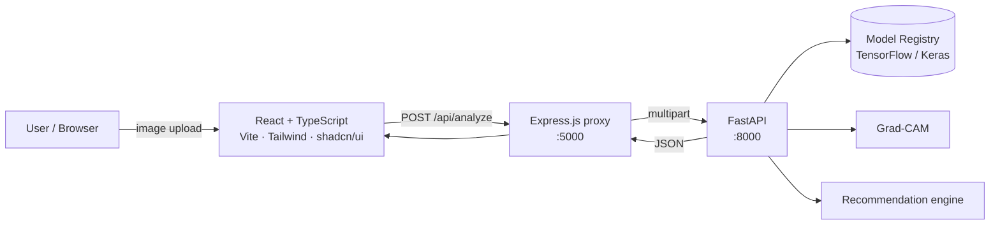

<div align="center">

# 🔬 SkinLens

**Detection and Information System of Skin Diseases Using Image Processing**

Deep-learning powered skin type, skin disease and skin concern analysis with explainable AI (Grad-CAM), delivered as a full-stack web application.


[🇹🇷 Türkçe](README.tr.md) · [Live Demo](#live-demo) · [Thesis](docs/thesis/) · [Model Card](docs/model-card.md) · [Architecture](docs/architecture.md)

</div>

> ⚠️ **Medical disclaimer.** SkinLens is an educational and preliminary-screening tool. It is **not** a medical device and must **not** replace professional dermatological diagnosis. If you notice a suspicious lesion, consult a dermatologist.

---

## Overview

Skin diseases affect roughly 900 million people worldwide (WHO), while access to dermatologists is limited in many regions. **SkinLens** is a B.Sc. graduation project (Üsküdar University, Software Engineering) that provides an accessible, explainable first-look analysis from a single photo.

It combines **three specialised deep-learning models**:

| Model | Task | Classes | Approach |
|---|---|---|---|
| **Skin Disease** | Disease detection | Acne, Atopic Dermatitis, Benign Lesion, Melanoma, Tinea/Ringworm/Candidiasis | DenseNet121, 3-stage training (class weights → fine-tuning → focal loss) |
| **Skin Type** | Skin type identification | Dry, Normal, Oily, Sensitive | Hybrid DenseNet121 + 26-dim Local Binary Pattern (LBP) |
| **Skin Concern** | Concern analysis | Acne, Blackheads, Pores, Wrinkles | EfficientNetB0, 2-stage training (frozen → fine-tune last 30 layers) |

Every prediction is accompanied by a **Grad-CAM heatmap**, and a **70 % confidence threshold** flags low-certainty results. A rule-based engine then produces personalised skincare routines and ingredient suggestions.

## Results

| Model | Test set | Accuracy | Macro F1 | Weighted F1 |
|---|---|---|---|---|
| Skin Disease (final, focal loss) | 1,430 images | **87.97 %** | 0.79 | 0.88 |
| Skin Type (hybrid CNN + LBP) | 235 images | **92.00 %** | 0.93 | 0.92 |
| Skin Concern (EfficientNetB0) | 771 images | **92.74 %** | 0.93 | 0.93 |

Disease model progression: Stage 1 **81.26 %** → Stage 2 (fine-tuning, val 85.02 %) → Stage 3 **87.97 %** (+6.71 pp).

> ⚠️ Skin-type accuracy was measured on a split with train/test overlap; see the [Model Card](docs/model-card.md#skin-type-model-hybrid-cnn--lbp). A leakage-free re-evaluation is in progress.

**Known limitation:** Melanoma remains the hardest class (F1 = 0.56, recall = 0.51, n = 59). Results are advisory only. See the [Model Card](docs/model-card.md) for per-class metrics and limitations.

## Features

- 4 analysis modes: Full Analysis · Skin Type · Disease Detection · Concern Detection
- Grad-CAM explainability overlays
- Confidence thresholding (70 %) with retry prompt
- Charts (bar / radar), personalised routines, ingredient and lifestyle tips
- Responsive UI, mandatory medical disclaimer on every result view

## Architecture



Details: [docs/architecture.md](docs/architecture.md)

## Repository Structure

```
SkinLens/
├── frontend/      # React + TypeScript SPA
├── server/        # Express.js gateway / reverse proxy
├── backend/       # FastAPI inference server (TensorFlow, Grad-CAM, recommendations)
├── training/      # Training code (skin_disease/, skin_type/, skin_concern/)
├── notebooks/     # Notebooks
├── models/        # Model files (not tracked – see models/README.md)
├── data/          # Dataset documentation (images not tracked – see data/README.md)
├── docs/          # Thesis, architecture, model card, deployment guide
└── scripts/       # Data audit, clean split, model download
```

## Getting Started

### Prerequisites
Python 3.11 · Node.js 18+ · the trained model files in `models/` (see [models/README.md](models/README.md))

### 1. Backend
```bash
cd backend
python -m venv .venv && source .venv/bin/activate   # Windows: .venv\Scripts\activate
pip install -r requirements.txt
uvicorn app.main:app --host 0.0.0.0 --port 8000
```

### 2. Server + Frontend
```bash
npm install
npm run build
npm start          # serves UI and proxies /api to http://localhost:8000
```

Copy `.env.example` to `.env` and adjust values if needed.

### API
`POST /api/analyze?mode={full|skin_type|disease|concern}` — `multipart/form-data`, field `file` (JPEG/PNG, max 8 MB). Returns predictions, confidences, Grad-CAM overlays and recommendations as JSON.

## Live Demo
> _Add link here after deployment (see [docs/deployment.md](docs/deployment.md))._

## Datasets

Raw datasets are **not** stored in this repository (size, licensing and privacy). See [data/README.md](data/README.md) for structure, sizes and sources.

## Tech Stack

Frontend: React 18, TypeScript, Vite, TailwindCSS, shadcn/ui, Framer Motion, Recharts · Middleware: Node.js, Express.js · AI backend: Python 3.11, FastAPI, TensorFlow/Keras, OpenCV, scikit-image · Data: ISIC archive, Kaggle MSC-6 and others.

## Future Work
Dermoscopy support · larger and more diverse data (skin tones, ages) · ensemble models · multimodal input · prospective clinical validation · native mobile app.

## Acknowledgements & Data Credits
- ISIC Archive (International Skin Imaging Collaboration) — dermoscopic lesion images.
- Kaggle *Multi-Class Skin Condition Image Dataset (MSC-6)* — skin type images.
- Roboflow-hosted community datasets — skin concern images.
- _If the disease dataset derives from the Kaggle "Skin Disease Classification Image Dataset" (riyaelizashaju), credit it here and respect its licence._
- Model backbones: DenseNet121 (Huang et al., 2017), EfficientNetB0 (Tan & Le, 2019), pretrained on ImageNet.

## Citation
```bibtex
@thesis{eraslan_skinlens,
  author = {Eraslan, Zehra},
  title  = {Detection and Information System of Skin Diseases Using Image Processing},
  school = {Üsküdar University},
  type   = {B.Sc. Thesis},
  year   = {2026}
}
```
See also [CITATION.cff](CITATION.cff).

## License
Code is released under the [MIT License](LICENSE). Datasets keep their original licences.

## Author
**Zehra Eraslan** — Software Engineering, Üsküdar University
