<div align="center">

# 🔬 SkinLens

**Detection and Information System of Skin Diseases Using Image Processing**

Deep-learning powered skin type, skin disease and skin concern analysis with explainable AI (Grad-CAM), delivered as a full-stack web application.


[🇹🇷 Türkçe](README.tr.md) · [Live Demo](#live-demo) · [Thesis](docs/thesis/) · [Model Card](docs/model-card.md) · [Architecture](docs/architecture.md)

</div>

> ⚠️ **Medical disclaimer.** SkinLens is an educational and preliminary-screening tool. It is **not** a medical device and must **not** replace professional dermatological diagnosis. If you notice a suspicious lesion, consult a dermatologist.

---

## Overview

Skin diseases affect roughly 900 million people worldwide (WHO), while access to dermatologists is limited in many regions. **SkinLens** is a B.Sc. graduation project (Üsküdar University, Software Engineering) that provides an accessible, explainable first-look analysis from a single photo.

It combines **three specialised deep-learning models**:

| Model | Task | Classes | Approach |
|---|---|---|---|
| **Skin Disease** | Disease detection | Acne, Atopic Dermatitis, Benign Lesion, Melanoma, Tinea/Ringworm/Candidiasis | DenseNet121, 3-stage training (class weights → fine-tuning → focal loss) |
| **Skin Type** | Skin type identification | Dry, Normal, Oily, Sensitive | Hybrid DenseNet121 + 26-dim Local Binary Pattern (LBP) |
| **Skin Concern** | Concern analysis | Acne, Blackheads, Pores, Wrinkles | EfficientNetB0, 2-stage training (frozen → fine-tune last 30 layers) |

Every prediction is accompanied by a **Grad-CAM heatmap**, and a **70 % confidence threshold** flags low-certainty results. A rule-based engine then produces personalised skincare routines and ingredient suggestions.

## Screenshots

<p align="center">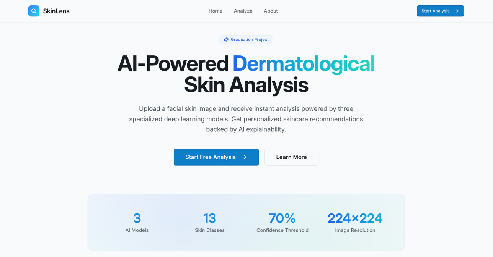</p>

| Select an analysis mode | How it works |
|---|---|
| 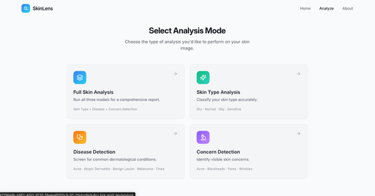 | 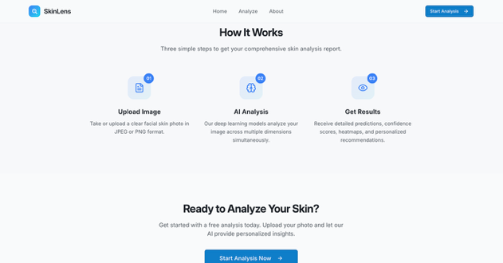 |
| **System pipeline and 70 % confidence gate** | **Recommendations and medical disclaimer** |
| 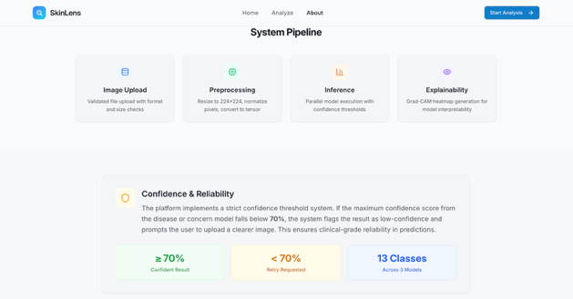 | 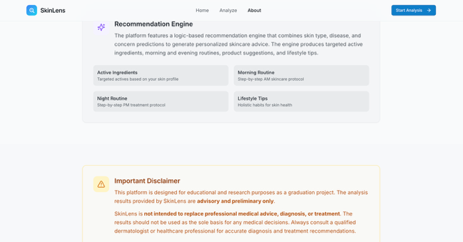 |

### Application walkthrough (real model output)

The images below are screenshots of the running application analysing one sample photo (close-up of nose skin): all predictions, Grad-CAM overlays and recommendations are produced by the three trained models and the rule-based engine.

| 1. Upload a photo | 2. Predictions with confidence |
|---|---|
| 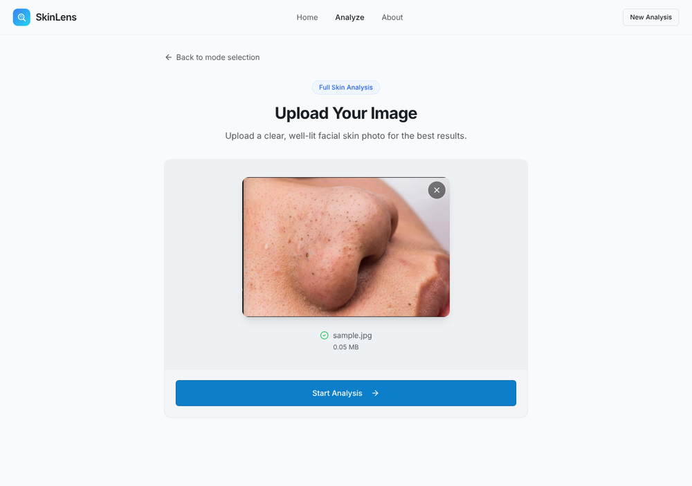 | 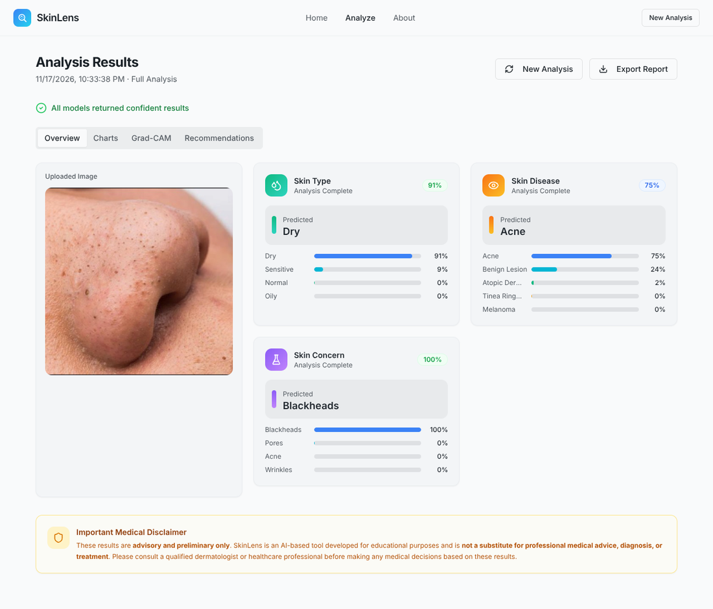 |
| **3. Grad-CAM heatmaps (disease / concern)** | **4. Personalised recommendations** |
| 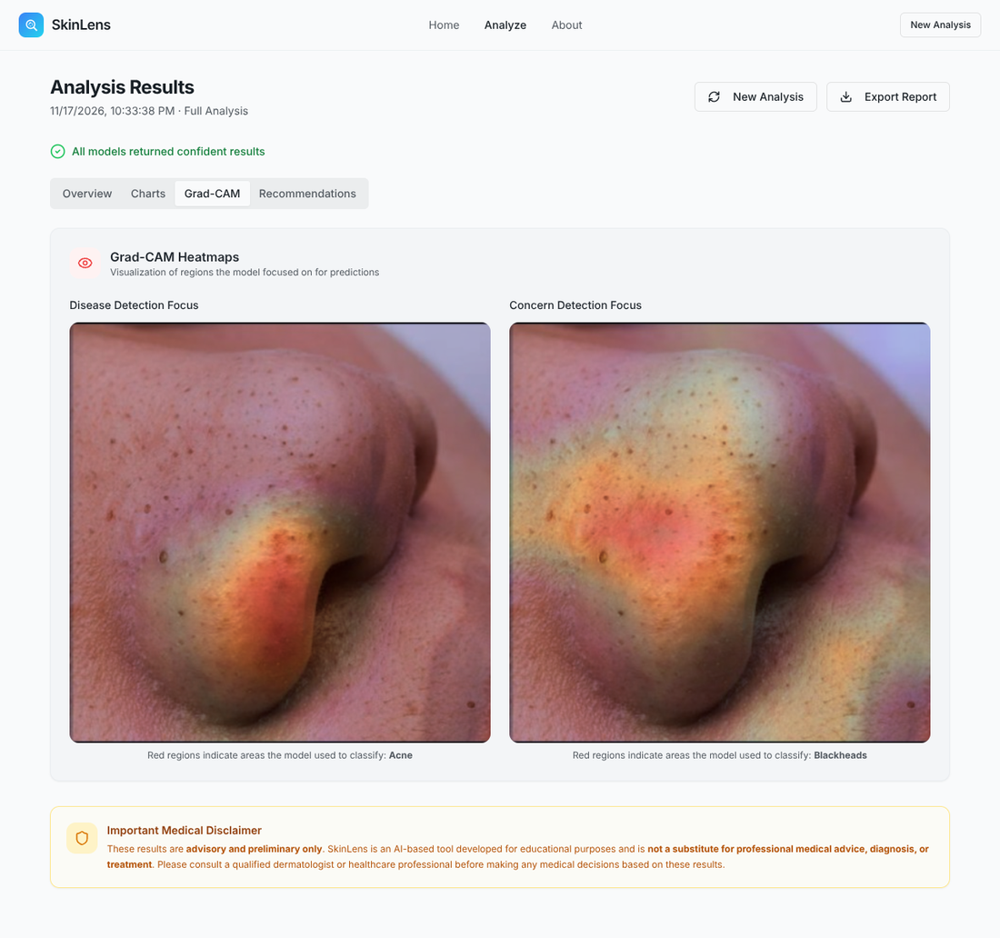 | 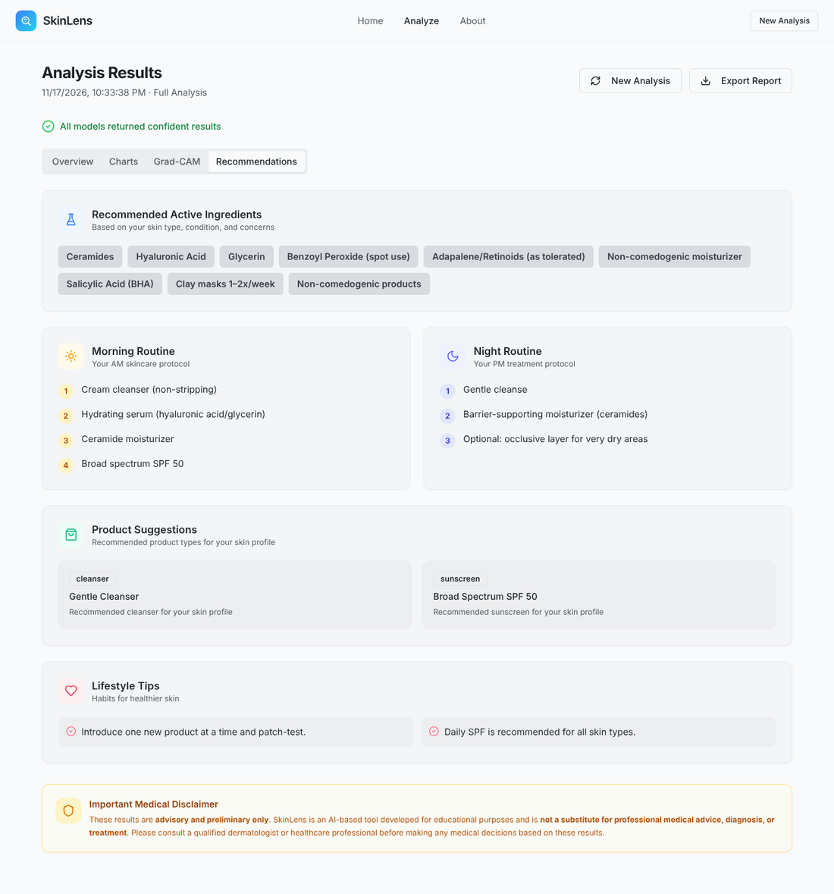 |

> The sample is only an illustration, not a diagnosis: the disease model labels it *Acne* with 75 % confidence, which shows how coarse its categories are. The disease model was not trained on facial photographs (see the limitations above).

## Results

| Model | Test set | Accuracy | Macro F1 | Weighted F1 |
|---|---|---|---|---|
| Skin Disease (final, focal loss) | 1,430 images | **87.97 %** | 0.79 | 0.88 |
| Skin Disease — leakage-free subset | 883 images | **85.96 %** | 0.78 | 0.86 |
| Skin Type (hybrid CNN + LBP) | 235 images | **92.34 %** | 0.93 | 0.92 |
| Skin Type — leakage-free subset | 169 images | **89.35 %** | – | – |
| Skin Concern — leakage-free subset | 521 images | **91.94 %** | – | – |
| Skin Concern (EfficientNetB0) | 771 images | **93.77 %** | 0.94 | 0.94 |

Disease model progression: Stage 1 **81.26 %** → Stage 2 (fine-tuning, val 85.02 %) → Stage 3 **87.97 %** (+6.71 pp).

> ⚠️ **Evaluation caveat.** 547 of the 1,430 disease test images (38.3 %) are byte-identical to training or validation images. On the remaining 883 unseen images accuracy is **85.96 %**; the headline 87.97 % is therefore slightly optimistic. Skin-type (65 of 235 test images identical to training images) and skin-concern (5 of 771) test sets also contain duplicates; leakage-free values are in the table above and in the [Model Card](docs/model-card.md).

> ⚠️ The disease model was trained on ISIC dermoscopy and clinical photographs of various body sites, **not on facial photographs**; image source is partly confounded with diagnosis. See [docs/dataset_provenance.md](docs/dataset_provenance.md).

**Known limitation:** Melanoma remains the hardest class (F1 = 0.56, recall = 0.51, n = 59). Results are advisory only. See the [Model Card](docs/model-card.md) for per-class metrics and limitations.

### Figures

<p align="center">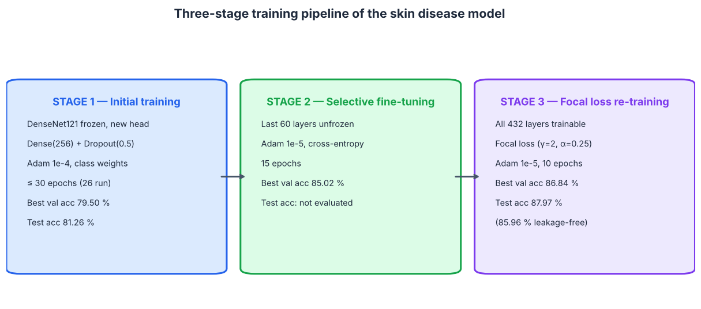</p>
<p align="center">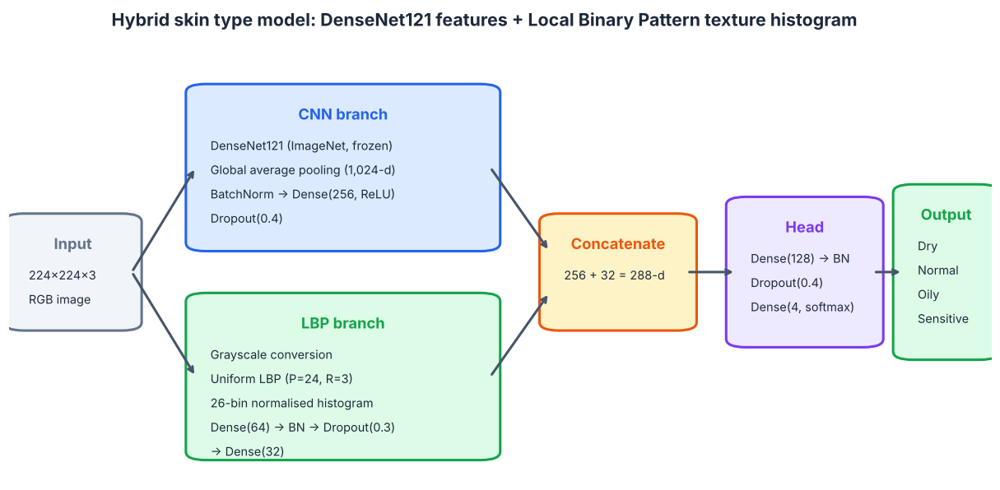</p>

| Skin type — training curves | Skin type — confusion matrix (test, n = 235) |
|---|---|
| 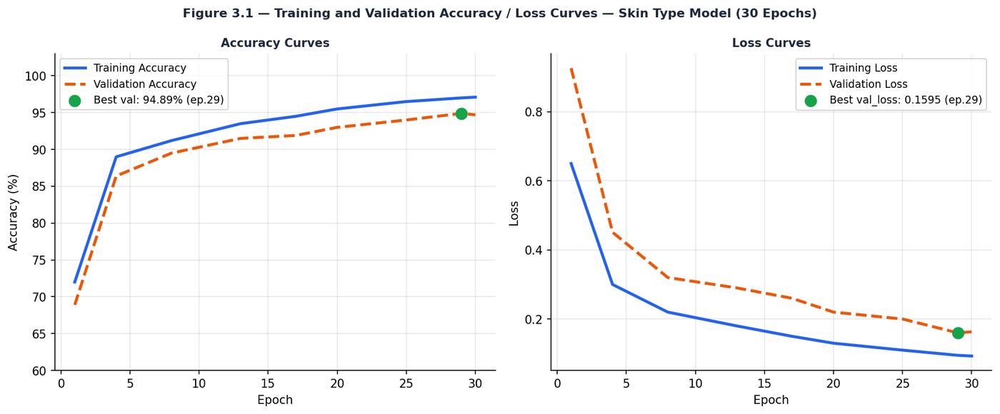 | 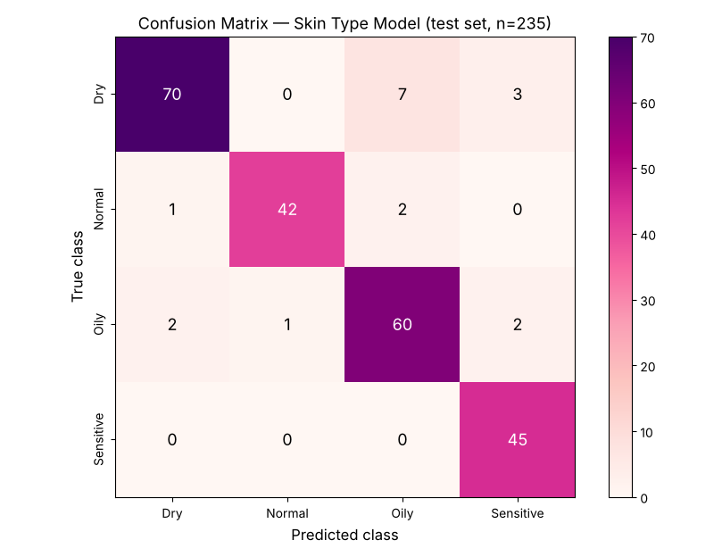 |
| **Skin concern — confusion matrix (test, n = 771)** | **Skin concern — Grad-CAM example** |
| 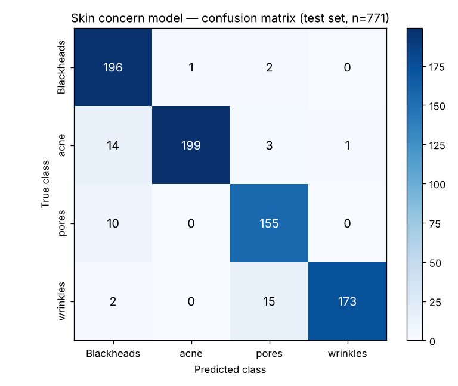 | 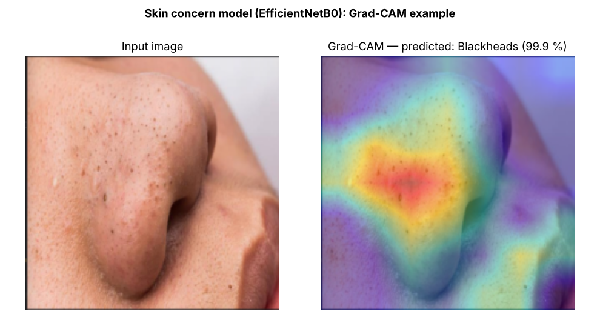 |

## Features

- 4 analysis modes: Full Analysis · Skin Type · Disease Detection · Concern Detection
- Grad-CAM explainability overlays
- Confidence thresholding (70 %) with retry prompt
- Charts (bar / radar), personalised routines, ingredient and lifestyle tips
- Responsive UI, mandatory medical disclaimer on every result view

## Architecture

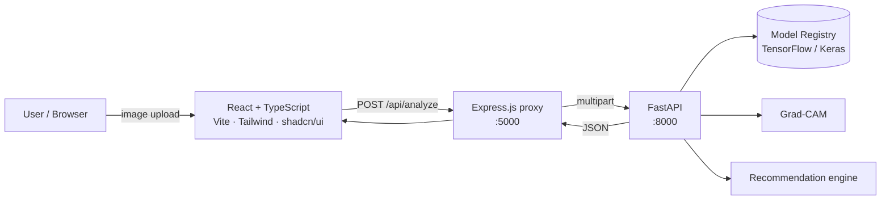

Details: [docs/architecture.md](docs/architecture.md)

## Repository Structure

```
SkinLens/
├── app/           # Web application: client (React), server (Express), python_backend (FastAPI + TensorFlow)
├── training/      # Training code (skin_disease/, skin_type/, skin_concern/)
├── scripts/       # Data audit, clean split, evaluation, model download
├── models/        # Model files (not tracked – see models/README.md)
├── data/          # Dataset documentation (images not tracked – see data/README.md)
├── deploy/        # Docker image for Hugging Face Spaces (free hosting)
└── docs/          # Thesis results, architecture, model card, deployment, changelog
```

## Getting Started

Prerequisites: Python 3.11+, Node.js 20+, and the trained models (see [models/README.md](models/README.md)).

```bash
python scripts/download_models.py          # downloads the 3 models into models/
cp models/*.keras models/*.h5 app/python_backend/models/

# terminal 1 — inference server
cd app/python_backend && python -m venv .venv && source .venv/bin/activate
pip install -r requirements.txt && ./run.sh        # http://localhost:8000

# terminal 2 — web server
cd app && npm install && npm run dev               # http://localhost:5000
```

### API
`POST /api/analyze` — `multipart/form-data`, field `image` (JPEG/PNG, max 8 MB) and `mode` (`full | skin_type | disease | concern`). Returns predictions, confidences, Grad-CAM overlays and recommendations as JSON. Details: [app/README.md](app/README.md).

## Live Demo

**https://zehraeraslan.github.io/SkinLens/** — a static demo hosted on GitHub Pages (always on, no cold start). Because the models cannot run in a browser tab, the demo replays **real, pre-computed model outputs for a sample image**; uploading your own photo is disabled and a banner says so. For live analysis of your own photos, run the full application locally (see *Getting Started*).

## Datasets

Raw datasets are **not** stored in this repository (size, licensing and privacy). See [data/README.md](data/README.md) for structure, sizes and sources.

## Tech Stack

Frontend: React 18, TypeScript, Vite, TailwindCSS, shadcn/ui, Framer Motion, Recharts · Middleware: Node.js, Express.js · AI backend: Python 3.11, FastAPI, TensorFlow/Keras, OpenCV, scikit-image · Data: ISIC archive, Kaggle MSC-6 and others.

## Future Work
Dermoscopy support · larger and more diverse data (skin tones, ages) · ensemble models · multimodal input · prospective clinical validation · native mobile app.

## Acknowledgements & Data Credits
- ISIC Archive (International Skin Imaging Collaboration) — dermoscopic lesion images.
- Kaggle *Multi-Class Skin Condition Image Dataset (MSC-6)* — skin type images.
- Roboflow-hosted community datasets — skin concern images.
- _If the disease dataset derives from the Kaggle "Skin Disease Classification Image Dataset" (riyaelizashaju), credit it here and respect its licence._
- Model backbones: DenseNet121 (Huang et al., 2017), EfficientNetB0 (Tan & Le, 2019), pretrained on ImageNet.

## Citation
```bibtex
@thesis{eraslan_skinlens,
  author = {Eraslan, Zehra},
  title  = {Detection and Information System of Skin Diseases Using Image Processing},
  school = {Üsküdar University},
  type   = {B.Sc. Thesis},
  year   = {2026}
}
```
See also [CITATION.cff](CITATION.cff).

## License
Code is released under the [MIT License](LICENSE). Datasets keep their original licences.

## Author
**Zehra Eraslan** — Software Engineering, Üsküdar University
