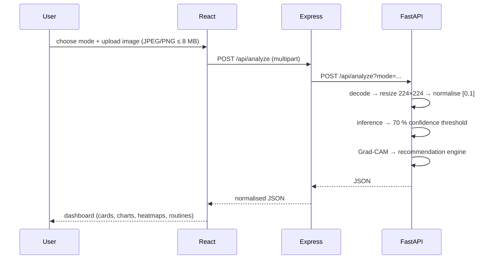

# System Architecture

Three-tier web application.

| Tier | Technology | Port | Role |
|---|---|---|---|
| Frontend | React 18, TypeScript, Vite, Tailwind, shadcn/ui, Framer Motion, Recharts | 5000 (served by Express) | UI, charts, Grad-CAM overlays |
| Middleware | Node.js, Express.js | 5000 | Static hosting, request validation, reverse proxy, label normalisation |
| AI Backend | Python 3.11, FastAPI, TensorFlow, OpenCV, scikit-image | 8000 | Inference, Grad-CAM, recommendations |

## Request lifecycle

## Key design decisions
- **Singleton `ModelRegistry`** loaded in a background thread at start-up (no per-request model loading).
- **70 % confidence gate** on all models; below it the UI asks for a better image.
- **Hybrid skin-type model:** DenseNet121 global-average-pooled features ⊕ 26-dim LBP histogram (radius 1, 8 points).
- **Disease training:** Stage 1 class-weighted CE (head only) → Stage 2 unfreeze last 60 layers, lr 1e-5 → Stage 3 focal loss (γ=2, α=0.25).
- Average latency for full analysis: 5–15 s (dominated by Grad-CAM).
